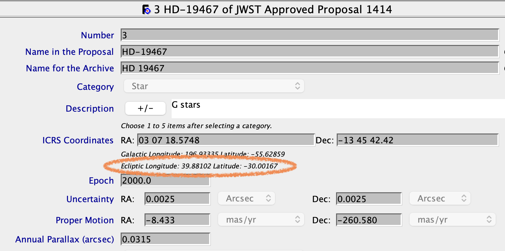
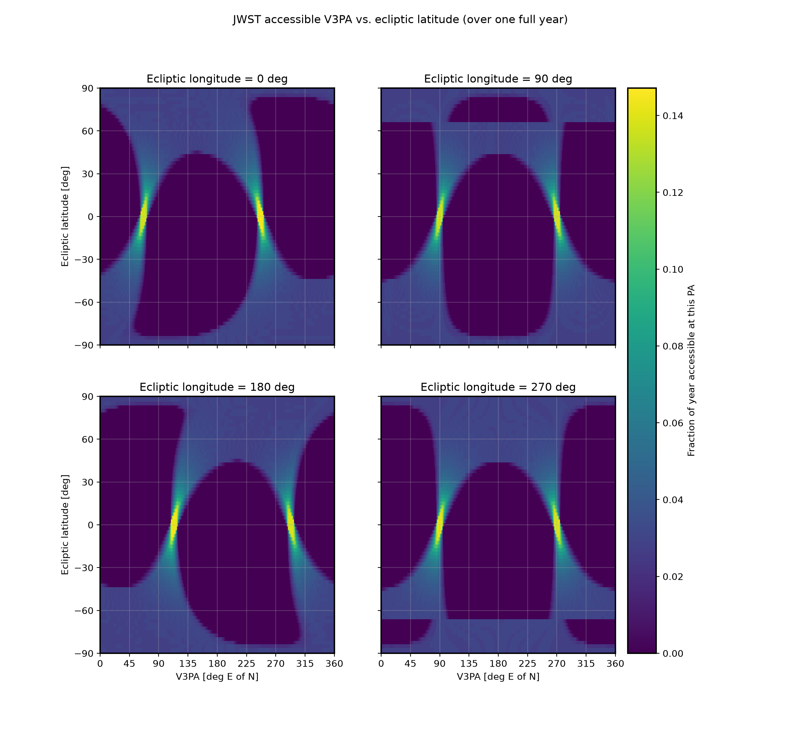
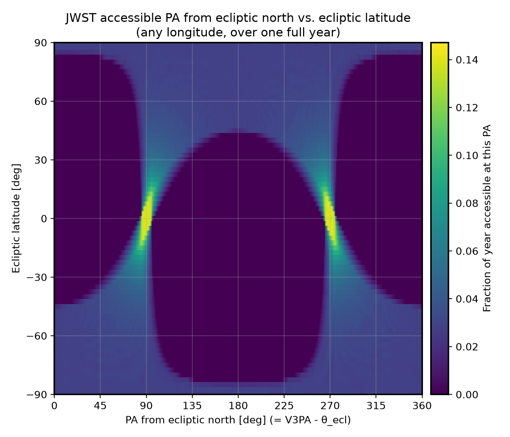
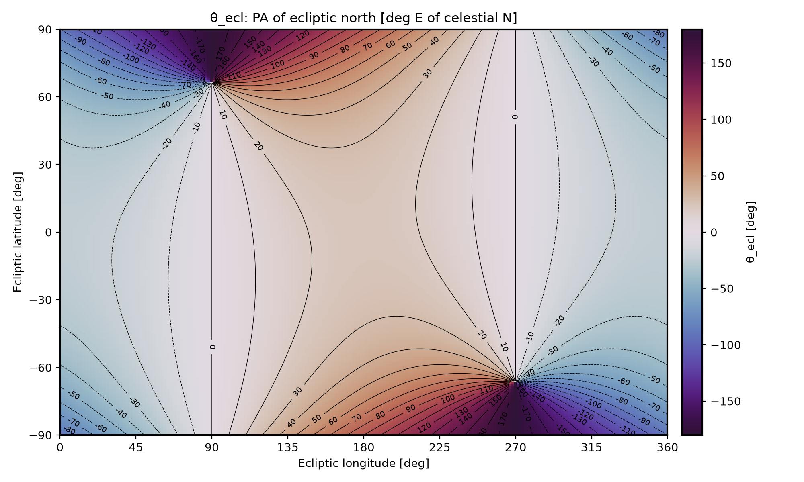

# JWST accessible V3PA vs. ecliptic latitude

A quick-look reference for planning JWST observations: given only a target's **ecliptic coordinates**, how much of the V3 position angle (V3PA) range can be reached over a full year? This avoids running `jwst_gtvt` for every target. The figures are generated by [`jwst_v3pa_vs_ecliptic_latitude.ipynb`](jwst_v3pa_vs_ecliptic_latitude.ipynb), which runs `jwst_gtvt` over a grid of ecliptic latitudes (−90° to +90°, 2.5° steps) and longitudes (0°, 90°, 180°, 270°).

## Why the allowed V3PA range depends on ecliptic latitude

JWST's sunshield forces the telescope to stay within a limited range of Sun angles (the field of regard), which in turn restricts the allowed roll, and hence V3PA, to a narrow range (about 10–15°) on any given day. As the Sun appears to move around the ecliptic through the year, that allowed range sweeps across V3PA:

- **Near the ecliptic** a target is observable in two short windows per year, each with a small, well-defined V3PA range. Only two narrow V3PA bands are ever accessible.
- **At higher ecliptic latitude** targets are visible for longer and the sweep covers more V3PA, so the bands widen and merge.
- **Near the ecliptic poles** (the continuous viewing zone) targets are visible all year and every V3PA is reachable at some time.

## Step 1: find the target's ecliptic coordinates in APT

The target form in the Astronomer's Proposal Tool (APT) lists the ecliptic longitude and latitude, just below the ICRS and Galactic coordinates (circled below).



In this example (HD 19467) the ecliptic longitude is 39.88° and the latitude is −30.00°.

## Step 2: read the accessible V3PA range

V3PA is measured east of **celestial** north, so the accessible bands shift with ecliptic longitude as well as latitude. The plot below shows the fraction of the year that each V3PA is accessible (brighter = more of the year), for four ecliptic longitudes. Pick the panel nearest your target's longitude (interpolating by eye in between) and read across at its ecliptic latitude.



Notes:

- Dark regions are never accessible. Colored regions are accessible for part of the year; the color gives the fraction of the year.
- The sharp edges at about +66.6° latitude (longitude 90°) and −66.6° (longitude 270°) occur where the target coincides with a celestial pole, where position angle is discontinuous. They are real, not a plotting glitch.
- The northern and southern hemispheres are not mirror images in these panels.

## Alternative view: PA from ecliptic north

If you prefer a single plot that does not depend on longitude, measure the position angle from **ecliptic** north instead of celestial north. In that frame the accessible range depends only on ecliptic latitude:



To convert back to the ordinary V3PA (east of celestial north), add the offset θ_ecl, the position angle of ecliptic north at your target's position, which can be read from the map below:

```
V3PA = PA_from_ecliptic_north + θ_ecl(ecliptic longitude, ecliptic latitude)
```



For the APT example above (longitude 39.88°, latitude −30.00°), θ_ecl is about −18°, so each PA read from the ecliptic-north plot at latitude −30° is shifted by −18° (mod 360°) to give V3PA.

## Caveats

- This is a planning aid, not a replacement for `jwst_gtvt` or APT's visit planner for scheduling, which also account for the exact dates and any additional constraints.
- Accessible ranges come from the `V3PA_min_pa_angle` / `V3PA_max_pa_angle` columns of `jwst_gtvt`, using only days when the target is inside the field of regard.
- Ranges were computed for 2024; the pattern repeats annually with negligible drift.
